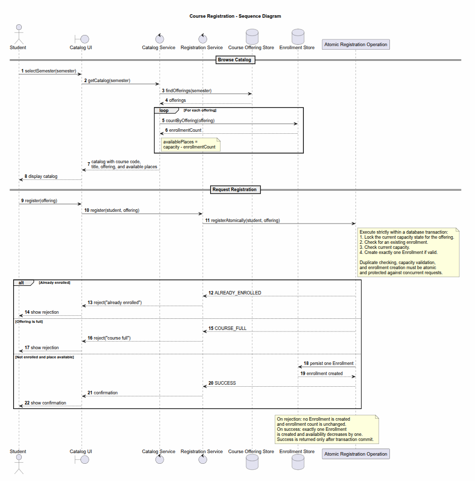
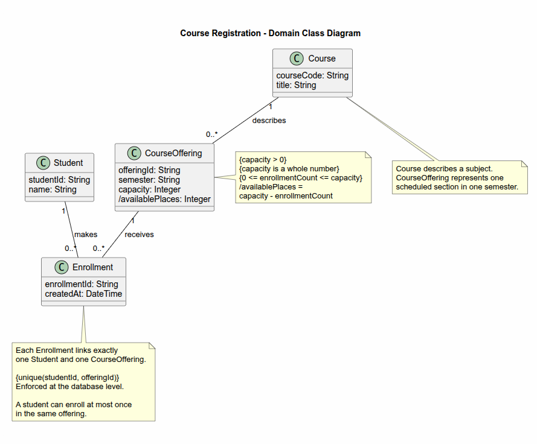
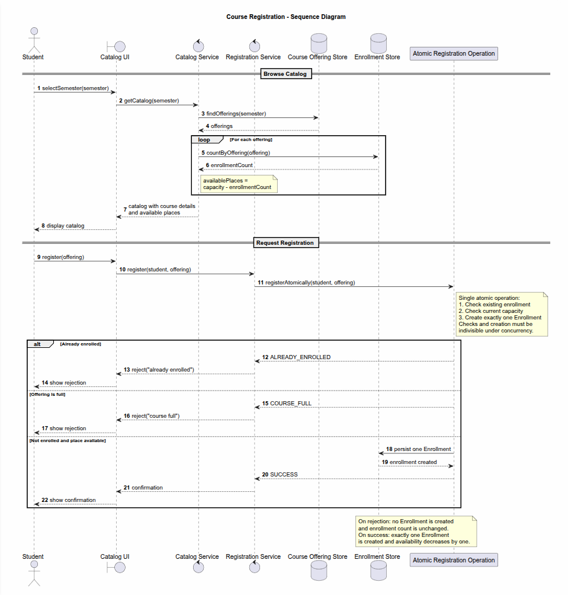
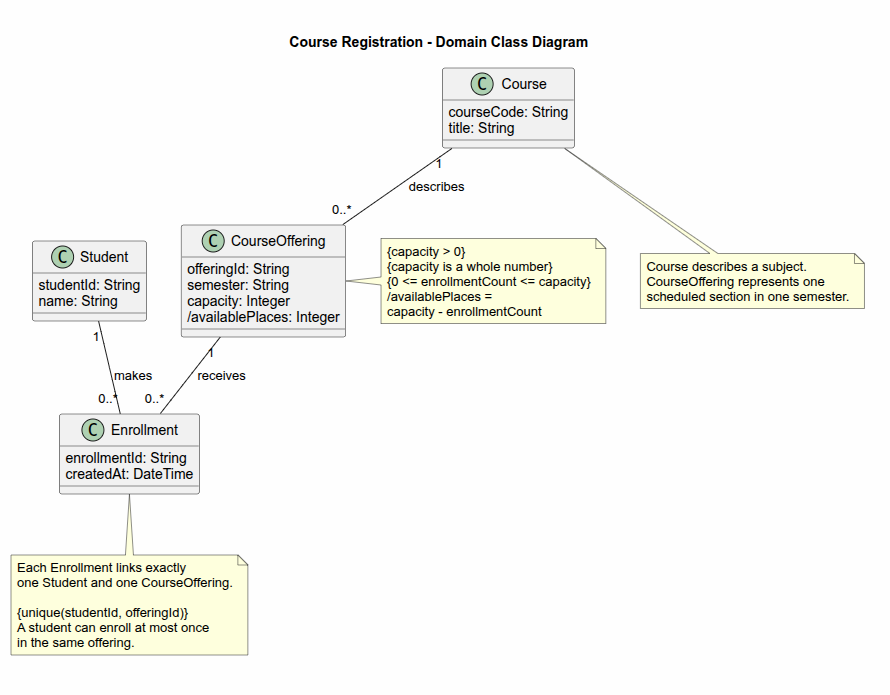

# SIS #02 — AI-Assisted UML Modeling: University Course Registration

## 1. Scope and assumptions

**Scope:** The system allows authenticated students to browse an electronic course catalog, select a specific course offering for a semester, and register for it, while strictly enforcing capacity limits and preventing duplicate enrollments. Payments, prerequisites, timetable clashes, waiting lists, and cancellation are out of scope.

**Assumptions:**

1. The student is already authenticated in the system before accessing the catalog.
2. The capacity of a course offering is a fixed positive whole number that does not change during the registration process.

## 2. User stories and acceptance criteria

### US-01 — Browse offerings

**US-01:** As a student, I want to browse the electronic course catalog for a selected semester, so that I can view course details, offerings, and available places.

- **AC-01** (R1): Given a student is viewing the electronic course catalog, When they select a semester, Then the system displays the course code, course title, course offering, and available places.
- **AC-02** (R1, R2): Given a course offering has a fixed capacity and current enrollments, When the system displays the offering in the catalog, Then the available places shown equal the capacity minus the current enrollment count.

### US-02 — Register for an offering

**US-02:** As a student, I want to register for a specific course offering, so that my enrollment is recorded and I receive a confirmation.

- **AC-03** (R2, R3, R4): Given a student is not already enrolled in the selected offering and at least one place is available, When the student requests registration for that offering, Then the system creates exactly one Enrollment linking the student to the offering, updates available places, and returns a confirmation.
- **AC-04** (R2, R5): Given the selected offering has reached its capacity, When the student requests registration, Then the system rejects the request with the explanation "course full", creates no Enrollment, and leaves the enrollment count unchanged.

### US-03 — Receive a clear rejection

**US-03:** As a student, I want to receive a clear explanation when my registration fails, so that I understand why the request was rejected.

- **AC-05** (R3, R5): Given a student is already enrolled in the selected offering, When the student requests registration for the same offering again, Then the system rejects the request with the explanation "already enrolled", creates no Enrollment, and leaves the enrollment count unchanged.
- **AC-06** (R5): Given a registration request is rejected for any reason, When the system processes the rejection, Then the system ensures no state is changed and the offering's enrollment count remains strictly unchanged.

## 3. Sequence diagram

**Participants:** Student (actor initiating request), Catalog UI (boundary interface), Catalog Service (control layer), Registration Service (control layer), Course Offering Store (database), Enrollment Store (database), Atomic Registration Operation (transaction boundary).

**Atomic operation:** The final duplicate check, current capacity check, and creation of the Enrollment are wrapped in a single database transaction lock. A catalog view reserves nothing because the availability can change before the registration transaction starts.

**Where the Enrollment is created:** The message "persist one Enrollment" sent to the Enrollment Store lifeline creates the Enrollment record.

**Technical lifelines:** Catalog UI, Catalog Service, Registration Service, Course Offering Store, Enrollment Store, Atomic Registration Operation. The class diagram models pure domain concepts, while these technical lifelines represent the actual software and database architecture needed to implement the workflow.

## 4. Class diagram

| Association | Read left to right | Read right to left |
| --- | --- | --- |
| Course -- CourseOffering | One Course describes 0..* CourseOffering | Each CourseOffering is described by exactly 1 Course |
| Student -- Enrollment | One Student makes 0..* Enrollment | Each Enrollment is made by exactly 1 Student |
| CourseOffering -- Enrollment | One CourseOffering receives 0..* Enrollment | Each Enrollment is received by exactly 1 CourseOffering |

**How an Enrollment links a student to an offering:** An Enrollment acts as an associative entity connecting exactly one Student to exactly one CourseOffering.

**Capacity constraint:** The enrollment count must be between 0 and the offering's capacity. Multiplicity alone cannot express this because multiplicity only specifies "many" (0..*), not a dynamically evaluated numeric limit.

**Uniqueness constraint:** A student can enroll at most once in the same offering (unique studentId and offeringId). Multiplicity alone cannot express this because 0..* on both sides does not inherently prevent duplicate links between the exact same pair of instances.

## 5. Traceability

| Rule and criterion | Model evidence | Validation case |
| --- | --- | --- |
| R1 + AC-01, AC-02 | Message: "catalog with course code, title, offering, and available places" | Visual inspection of sequence diagram |
| R2 + AC-02, AC-03, AC-04 | Note: "Check current capacity", Constraint: "0 <= enrollmentCount <= capacity" | T1, T2, T3 |
| R3 + AC-03, AC-05 | Note: "Check for an existing enrollment", Constraint: "{unique(studentId, offeringId)}" | T4 |
| R4 + AC-03 | Message: "persist one Enrollment", Message: "confirmation" | T1, T2 |
| R5 + AC-04, AC-05, AC-06 | Guards: "[Already enrolled]" and "[Offering is full]" changing no state | T3, T4 |

## 6. Walkthroughs

| Case | Observed path and state change | Judgment and evidence |
| --- | --- | --- |
| T1. Available | Path: requests registration -> atomic tx locks state -> no duplicate -> capacity ok -> persist Enrollment -> confirm. State change: count 0 becomes 1. | Pass — "Not enrolled and place available" branch |
| T2. Last place | Path: requests registration -> atomic tx locks state -> no duplicate -> capacity ok -> persist Enrollment -> confirm. State change: count 1 becomes 2. | Pass — "Not enrolled and place available" branch |
| T3. Full | Path: requests registration -> atomic tx locks state -> no duplicate -> capacity check fails -> reject("course full"). State change: count stays 2. | Pass — "Offering is full" branch |
| T4. Duplicate | Path: requests registration -> atomic tx locks state -> duplicate check fails -> reject("already enrolled"). State change: count stays 1. | Pass — "Already enrolled" branch |

## 7. Review decisions

| AI suggestion or model element | Decision | Reason | Rule |
| --- | --- | --- | --- |
| Explicit atomicity guarantee in sequence diagram | Accepted | A stale catalog view can lead to over-enrollment if the final capacity check and enrollment creation are not strictly protected by a database transaction. | R2 |
| Database-enforced uniqueness in class diagram | Accepted | Application-level duplicate checks are vulnerable to race conditions, so uniqueness must be explicitly enforced at the persistent storage layer. | R3 |
| Clarify catalog response message in sequence diagram | Accepted | The current message is too generic ("course details"); explicitly listing course code, title, and offering ensures strict compliance with the display requirements. | R1 |

## 8. Modeling explanation

The system is modeled using a domain class diagram to capture static structures and a sequence diagram for the dynamic registration workflow. My main design choice was to keep the domain model strictly focused on business concepts (Student, Course, CourseOffering, Enrollment) without polluting it with UI or database classes. This separation of concerns ensures that the core constraints—such as the uniqueness of an enrollment and the capacity limits—are clearly stated as business rules in notes, since standard UML multiplicities (0..*) cannot enforce dynamic numeric boundaries or prevent duplicate links between the same instance pairs. The sequence diagram complements this by showing how these static rules are actively enforced during a registration attempt. It introduces technical lifelines, such as the Registration Service and an Atomic Registration Operation, to illustrate the exact timing and coordination of validations. Crucially, the sequence diagram demonstrates that a catalog view merely displays a snapshot of availability, while the actual registration strictly relies on a database transaction to lock the state, check capacity, and prevent duplicate enrollments concurrently. An activity diagram could also help explain this workflow because it visually maps out the parallel decision branches (success, full course, already enrolled) as a flowchart. While the sequence diagram emphasizes which component sends which message over time, an activity diagram would make the overall logical routing and conditional paths more accessible to non-technical stakeholders reviewing the business processes.

## 9. Reflection

Working with the AI assistant significantly accelerated the initial drafting phase of both UML models. It accurately mapped the textual rules to the appropriate structural classes and identified the necessary operational branches in the sequence diagram. However, one specific decision I made myself was to heavily revise the concurrency logic. The AI's original draft relied on a conceptual 'atomic operation' without explicitly defining that the checks and the creation must occur within a strict database transaction lock. I forced the assistant to revise the sequence diagram to explicitly state that the duplicate check, capacity validation, and enrollment creation happen under a locked state, preventing race conditions from stale catalog views. One remaining limitation of this model is that it does not detail the exact database locking mechanism or isolation level required (e.g., pessimistic vs. optimistic locking). The diagrams abstract this into a single atomic block. While sufficient for a high-level requirements overview, a development team would need further architectural specification to safely implement the transaction management without causing severe performance bottlenecks during peak registration periods.

## 10. Appendix A — Before AI

**Scope:** The system allows authenticated students to browse an electronic course catalog, select a specific course offering for a semester, and register for it, while strictly enforcing capacity limits and preventing duplicate enrollments.

**Initial assumptions:**

1. The student is already authenticated in the system before accessing the catalog.
2. The capacity of a course offering is a fixed positive whole number that does not change during the registration process.

## 11. Appendix B — AI exchanges

### B1 — Requirements (Prompt A)

- **Tool:** ChatGPT
- **Model:** GPT-4o
- **Date:** 2026-10-17
- **Purpose:** draft 3 user stories and 6 acceptance criteria

**Prompt:**

~~~~text
Act as a requirements analyst. Use only this course registration scenario and rules R1–R5: A student browses an electronic course catalog, chooses a course offering and requests registration. Each offering has a limited number of places. A Course describes a subject. A CourseOffering is one scheduled section in one semester. Registration always targets a specific offering. Assume that the student is signed in, the selected offering exists, and its capacity is a positive whole number. Exclude payments, prerequisites, timetable clashes, waiting lists and cancellation. Use fictional students and courses. R1. Catalog: Show the course code, title, offering and available places for one semester. R2. Capacity: Recheck current availability when registering. Enrollment must never exceed the offering's capacity. R3. Duplicates: A student may have at most one enrollment in the same offering. Reject a repeat request. R4. Success: Create exactly one Enrollment linking the student and offering, update availability and return a confirmation. R5. Rejection: Explain "course full" or "already enrolled". Create no enrollment and leave the enrollment count unchanged. My initial assumptions are 1. The student is already authenticated in the system before accessing the catalog. 2. The capacity of a course offering is a fixed positive whole number that does not change during the registration process.
Draft 3 user stories and 2 Given / When / Then acceptance criteria for each. Use IDs US-01 to US-03 and AC-01 to AC-06. Map each criterion to rule IDs.
Cover normal and rejection behavior. List uncertainty separately. Do not add excluded features or invent university policies.
~~~~

**Response:**

~~~~text
User Stories and Acceptance Criteria: Course Registration System
1. User stories
US-01 — Browse course catalog
As a student, I want to browse the electronic course catalog for a selected semester so that I can view course details, available offerings, and the number of available places.
US-02 — Register for a course offering
As a student, I want to register for a specific course offering so that my enrollment is recorded and I receive a confirmation if registration succeeds.
US-03 — Handle rejected registration requests
As a student, I want to receive a clear explanation when my registration is rejected because the offering is full or I am already enrolled, so that I understand why registration failed.
2. Acceptance criteria
US-01 — Browse course catalog
AC-01 — Display course catalogMapped rules: R1
- Given a signed-in student is viewing the electronic course catalog and a semester is selected
- When the student browses the catalog
- Then the system displays the course code, course title, course offering, and available places for that semester.
AC-02 — Display available places accuratelyMapped rules: R1, R2
- Given a course offering has a fixed capacity and a current enrollment count
- When the system displays the offering in the catalog
- Then the available places equal the offering's capacity minus its current enrollment count.
US-02 — Register for a course offering
AC-03 — Successful registrationMapped rules: R2, R3, R4
- Given a student is not already enrolled in the selected offering and at least one place is available
- When the student requests registration for that offering
- Then the system creates exactly one Enrollment linking the student to that specific offering, updates the available places, and returns a confirmation.
AC-04 — Enforce capacity during registrationMapped rules: R2, R5
- Given the selected offering has reached its capacity when registration is processed
- When the student requests registration
- Then the system rejects the request with the explanation "course full", creates no Enrollment, and leaves the enrollment count unchanged.
US-03 — Handle rejected registration requests
AC-05 — Reject duplicate enrollmentMapped rules: R3, R5
- Given a student is already enrolled in the selected offering
- When the student requests registration for the same offering again
- Then the system rejects the request with the explanation "already enrolled", creates no Enrollment, and leaves the enrollment count unchanged.
AC-06 — Preserve enrollment count after rejectionMapped rules: R2, R5
- Given a student requests registration for an offering that is full or in which the student is already enrolled
- When the system rejects the request
- Then no Enrollment is created and the enrollment count remains unchanged.
~~~~

### B2 — UML drafts (Prompt B)

- **Tool:** ChatGPT
- **Model:** GPT-4o
- **Date:** 2026-10-17
- **Purpose:** draft the sequence and class diagrams

**Prompt:**

~~~~text
Using my approved scenario, R1–R5, stories and criteria below, return separate PlantUML code blocks for a sequence diagram and a domain class diagram.
Sequence: include catalog browsing and guarded success, full-course and duplicate outcomes. Model final checks and creation as one atomic operation.
Class: show domain concepts, useful attributes and multiplicities. State the capacity and uniqueness constraints. Explain assumptions and any technical lifelines.

Approved requirements:
US-01: As a student, I want to browse the electronic course catalog for a selected semester, so that I can view course details, offerings, and available places.
- AC-01 (R1): Given a student is viewing the electronic course catalog, When they select a semester, Then the system displays the course code, course title, course offering, and available places.
- AC-02 (R1, R2): Given a course offering has a fixed capacity and current enrollments, When the system displays the offering in the catalog, Then the available places shown equal the capacity minus the current enrollment count.
US-02: As a student, I want to register for a specific course offering, so that my enrollment is recorded and I receive a confirmation.
- AC-03 (R2, R3, R4): Given a student is not already enrolled in the selected offering and at least one place is available, When the student requests registration for that offering, Then the system creates exactly one Enrollment linking the student to the offering, updates available places, and returns a confirmation.
- AC-04 (R2, R5): Given the selected offering has reached its capacity, When the student requests registration, Then the system rejects the request with the explanation "course full", creates no Enrollment, and leaves the enrollment count unchanged.
US-03: As a student, I want to receive a clear explanation when my registration fails, so that I understand why the request was rejected.
- AC-05 (R3, R5): Given a student is already enrolled in the selected offering, When the student requests registration for the same offering again, Then the system rejects the request with the explanation "already enrolled", creates no Enrollment, and leaves the enrollment count unchanged.
- AC-06 (R5): Given a registration request is rejected for any reason, When the system processes the rejection, Then the system ensures no state is changed and the offering's enrollment count remains strictly unchanged.
~~~~

**Response:**

~~~~text
Sequence diagram — PlantUML
@startuml
title Course Registration - Sequence Diagram
autonumber
actor Student
boundary "Catalog UI" as UI
control "Catalog Service" as CS
control "Registration Service" as RS
database "Course Offering Store" as OS
database "Enrollment Store" as ES
participant "Atomic Registration Operation" as TX
== Browse Catalog ==
Student -> UI: selectSemester(semester)
UI -> CS: getCatalog(semester)
CS -> OS: findOfferings(semester)
OS --> CS: offerings
loop For each offering
    CS -> ES: countByOffering(offering)
    ES --> CS: enrollmentCount
    note right of CS
      availablePlaces =
      capacity - enrollmentCount
    end note
end
CS --> UI: catalog with course details\nand available places
UI --> Student: display catalog
== Request Registration ==
Student -> UI: register(offering)
UI -> RS: register(student, offering)
RS -> TX: registerAtomically(student, offering)
note right of TX
  Single atomic operation:
1. Check existing enrollment
2. Check current capacity
3. Create exactly one Enrollment
  Checks and creation must be
  indivisible under concurrency.
end note
alt Already enrolled
    TX --> RS: ALREADY_ENROLLED
    RS --> UI: reject("already enrolled")
    UI --> Student: show rejection
else Offering is full
    TX --> RS: COURSE_FULL
    RS --> UI: reject("course full")
    UI --> Student: show rejection
else Not enrolled and place available
    TX -> ES: persist one Enrollment
    ES --> TX: enrollment created
    TX --> RS: SUCCESS
    RS --> UI: confirmation
    UI --> Student: show confirmation
end
note over TX, ES
  On rejection: no Enrollment is created
  and enrollment count is unchanged.
  On success: exactly one Enrollment
  is created and availability decreases by one.
end note
@enduml

Domain class diagram — PlantUML
@startuml
title Course Registration - Domain Class Diagram
skinparam classAttributeIconSize 0
class Student {
  studentId: String
  name: String
}
class Course {
  courseCode: String
  title: String
}
class CourseOffering {
  offeringId: String
  semester: String
  capacity: Integer
  /availablePlaces: Integer
}
class Enrollment {
  enrollmentId: String
  createdAt: DateTime
}
Course "1" -- "0..*" CourseOffering : describes
Student "1" -- "0..*" Enrollment : makes
CourseOffering "1" -- "0..*" Enrollment : receives
note right of CourseOffering
  {capacity > 0}
  {capacity is a whole number}
  {0 <= enrollmentCount <= capacity}
  /availablePlaces =
  capacity - enrollmentCount
end note
note bottom of Enrollment
  Each Enrollment links exactly
  one Student and one CourseOffering.
  {unique(studentId, offeringId)}
  A student can enroll at most once
  in the same offering.
end note
note bottom of Course
  Course describes a subject.
  CourseOffering represents one
  scheduled section in one semester.
end note
@enduml
~~~~

### B3 — Model critique (Prompt C)

- **Tool:** ChatGPT
- **Model:** GPT-4o
- **Date:** 2026-10-17
- **Purpose:** review both models against R1–R5 and T1–T4

**Prompt:**

~~~~text
Review these two UML models against R1–R5 and my acceptance criteria. Check message order, guards, state changes, multiplicities and naming.
Inspect the four validation cases: available places, exactly one place, full course after a stale catalog view, and duplicate registration.
For each issue, cite the affected rule and model element. Explain the impact and propose a focused correction. Separate genuine defects from optional design choices.

Original Sequence Diagram:
@startuml
title Course Registration - Sequence Diagram
autonumber
actor Student
boundary "Catalog UI" as UI
control "Catalog Service" as CS
control "Registration Service" as RS
database "Course Offering Store" as OS
database "Enrollment Store" as ES
participant "Atomic Registration Operation" as TX
== Browse Catalog ==
Student -> UI: selectSemester(semester)
UI -> CS: getCatalog(semester)
CS -> OS: findOfferings(semester)
OS --> CS: offerings
loop For each offering
    CS -> ES: countByOffering(offering)
    ES --> CS: enrollmentCount
    note right of CS
      availablePlaces =
      capacity - enrollmentCount
    end note
end
CS --> UI: catalog with course details\nand available places
UI --> Student: display catalog
== Request Registration ==
Student -> UI: register(offering)
UI -> RS: register(student, offering)
RS -> TX: registerAtomically(student, offering)
note right of TX
  Single atomic operation:
1. Check existing enrollment
2. Check current capacity
3. Create exactly one Enrollment
  Checks and creation must be
  indivisible under concurrency.
end note
alt Already enrolled
    TX --> RS: ALREADY_ENROLLED
    RS --> UI: reject("already enrolled")
    UI --> Student: show rejection
else Offering is full
    TX --> RS: COURSE_FULL
    RS --> UI: reject("course full")
    UI --> Student: show rejection
else Not enrolled and place available
    TX -> ES: persist one Enrollment
    ES --> TX: enrollment created
    TX --> RS: SUCCESS
    RS --> UI: confirmation
    UI --> Student: show confirmation
end
note over TX, ES
  On rejection: no Enrollment is created
  and enrollment count is unchanged.
  On success: exactly one Enrollment
  is created and availability decreases by one.
end note
@enduml

Original Class Diagram:
@startuml
title Course Registration - Domain Class Diagram
skinparam classAttributeIconSize 0
class Student {
  studentId: String
  name: String
}
class Course {
  courseCode: String
  title: String
}
class CourseOffering {
  offeringId: String
  semester: String
  capacity: Integer
  /availablePlaces: Integer
}
class Enrollment {
  enrollmentId: String
  createdAt: DateTime
}
Course "1" -- "0..*" CourseOffering : describes
Student "1" -- "0..*" Enrollment : makes
CourseOffering "1" -- "0..*" Enrollment : receives
note right of CourseOffering
  {capacity > 0}
  {capacity is a whole number}
  {0 <= enrollmentCount <= capacity}
  /availablePlaces =
  capacity - enrollmentCount
end note
note bottom of Enrollment
  Each Enrollment links exactly
  one Student and one CourseOffering.
  {unique(studentId, offeringId)}
  A student can enroll at most once
  in the same offering.
end note
note bottom of Course
  Course describes a subject.
  CourseOffering represents one
  scheduled section in one semester.
end note
@enduml

Approved Requirements:
US-01: As a student, I want to browse the electronic course catalog for a selected semester, so that I can view course details, offerings, and available places.
- AC-01 (R1): Given a student is viewing the electronic course catalog, When they select a semester, Then the system displays the course code, course title, course offering, and available places.
- AC-02 (R1, R2): Given a course offering has a fixed capacity and current enrollments, When the system displays the offering in the catalog, Then the available places shown equal the capacity minus the current enrollment count.
US-02: As a student, I want to register for a specific course offering, so that my enrollment is recorded and I receive a confirmation.
- AC-03 (R2, R3, R4): Given a student is not already enrolled in the selected offering and at least one place is available, When the student requests registration for that offering, Then the system creates exactly one Enrollment linking the student to the offering, updates available places, and returns a confirmation.
- AC-04 (R2, R5): Given the selected offering has reached its capacity, When the student requests registration, Then the system rejects the request with the explanation "course full", creates no Enrollment, and leaves the enrollment count unchanged.
US-03: As a student, I want to receive a clear explanation when my registration fails, so that I understand why the request was rejected.
- AC-05 (R3, R5): Given a student is already enrolled in the selected offering, When the student requests registration for the same offering again, Then the system rejects the request with the explanation "already enrolled", creates no Enrollment, and leaves the enrollment count unchanged.
- AC-06 (R5): Given a registration request is rejected for any reason, When the system processes the rejection, Then the system ensures no state is changed and the offering's enrollment count remains strictly unchanged.
~~~~

**Response:**

~~~~text
UML review: Course Registration System
The two models are mostly consistent with the approved requirements, and the sequence diagram correctly identifies the need for an atomic registration operation. However, there are several issues to distinguish between actual defects, ambiguities, and optional design choices.

Case 3 — Course becomes full after a stale catalog view (Partially specified)
Rule: R2, R4, R5; AC-02, AC-04, AC-06.
Model elements: Atomic Registration Operation, Check current capacity, else Offering is full.
Issue: The sequence diagram does not explicitly show how the operation obtains or protects the latest enrollment count and capacity during the final check.
Correction: Specify that the operation reads and validates current persistent state and performs the capacity check and enrollment creation atomically, using appropriate transaction isolation, locking, or an equivalent concurrency-safe mechanism.

Case 4 — Duplicate registration (Implementation caveat)
Rule: R3, R5; AC-05, AC-06.
Model elements: Check existing enrollment, alt Already enrolled, {unique(studentId, offeringId)}.
Issue: Application-level duplicate checks are vulnerable.
Correction: Enforce the uniqueness constraint in persistent storage, not just in application-level logic. The uniqueness check and creation must be protected against simultaneous duplicate requests.

Sequence diagram review: R1, AC-01
CS --> UI: catalog with course details and available places
Correct. Clarify that the response includes course code, title, and offering details, not just a generic catalog.
~~~~

### B4 — Focused revision (Prompt D)

- **Tool:** ChatGPT
- **Model:** GPT-4o
- **Date:** 2026-10-17
- **Purpose:** apply my accepted review decisions

**Prompt:**

~~~~text
Revise the UML sources using only my accepted review decisions:
1. Sequence diagram: Add a note or clarify that the Atomic Registration Operation strictly uses a database transaction to lock the current capacity, check for duplicates, and create the enrollment.
2. Class diagram: Explicitly state in the Enrollment uniqueness note that this constraint is enforced at the database level.
3. Sequence diagram: Update the catalog return message to explicitly name "course code, title, offering, and available places" instead of just "course details".

Keep justified existing elements and explain each change.
Preserve the agreed scope and rule IDs. Return both updated PlantUML blocks and a concise change log. Flag any unresolved issue.

Approved requirements:
US-01: As a student, I want to browse the electronic course catalog for a selected semester, so that I can view course details, offerings, and available places.
- AC-01 (R1): Given a student is viewing the electronic course catalog, When they select a semester, Then the system displays the course code, course title, course offering, and available places.
- AC-02 (R1, R2): Given a course offering has a fixed capacity and current enrollments, When the system displays the offering in the catalog, Then the available places shown equal the capacity minus the current enrollment count.
US-02: As a student, I want to register for a specific course offering, so that my enrollment is recorded and I receive a confirmation.
- AC-03 (R2, R3, R4): Given a student is not already enrolled in the selected offering and at least one place is available, When the student requests registration for that offering, Then the system creates exactly one Enrollment linking the student to the offering, updates available places, and returns a confirmation.
- AC-04 (R2, R5): Given the selected offering has reached its capacity, When the student requests registration, Then the system rejects the request with the explanation "course full", creates no Enrollment, and leaves the enrollment count unchanged.
US-03: As a student, I want to receive a clear explanation when my registration fails, so that I understand why the request was rejected.
- AC-05 (R3, R5): Given a student is already enrolled in the selected offering, When the student requests registration for the same offering again, Then the system rejects the request with the explanation "already enrolled", creates no Enrollment, and leaves the enrollment count unchanged.
- AC-06 (R5): Given a registration request is rejected for any reason, When the system processes the rejection, Then the system ensures no state is changed and the offering's enrollment count remains strictly unchanged.

Original sources:
@startuml
title Course Registration - Sequence Diagram
autonumber
actor Student
boundary "Catalog UI" as UI
control "Catalog Service" as CS
control "Registration Service" as RS
database "Course Offering Store" as OS
database "Enrollment Store" as ES
participant "Atomic Registration Operation" as TX
== Browse Catalog ==
Student -> UI: selectSemester(semester)
UI -> CS: getCatalog(semester)
CS -> OS: findOfferings(semester)
OS --> CS: offerings
loop For each offering
    CS -> ES: countByOffering(offering)
    ES --> CS: enrollmentCount
    note right of CS
      availablePlaces =
      capacity - enrollmentCount
    end note
end
CS --> UI: catalog with course details\nand available places
UI --> Student: display catalog
== Request Registration ==
Student -> UI: register(offering)
UI -> RS: register(student, offering)
RS -> TX: registerAtomically(student, offering)
note right of TX
  Single atomic operation:
1. Check existing enrollment
2. Check current capacity
3. Create exactly one Enrollment
  Checks and creation must be
  indivisible under concurrency.
end note
alt Already enrolled
    TX --> RS: ALREADY_ENROLLED
    RS --> UI: reject("already enrolled")
    UI --> Student: show rejection
else Offering is full
    TX --> RS: COURSE_FULL
    RS --> UI: reject("course full")
    UI --> Student: show rejection
else Not enrolled and place available
    TX -> ES: persist one Enrollment
    ES --> TX: enrollment created
    TX --> RS: SUCCESS
    RS --> UI: confirmation
    UI --> Student: show confirmation
end
note over TX, ES
  On rejection: no Enrollment is created
  and enrollment count is unchanged.
  On success: exactly one Enrollment
  is created and availability decreases by one.
end note
@enduml

@startuml
title Course Registration - Domain Class Diagram
skinparam classAttributeIconSize 0
class Student {
  studentId: String
  name: String
}
class Course {
  courseCode: String
  title: String
}
class CourseOffering {
  offeringId: String
  semester: String
  capacity: Integer
  /availablePlaces: Integer
}
class Enrollment {
  enrollmentId: String
  createdAt: DateTime
}
Course "1" -- "0..*" CourseOffering : describes
Student "1" -- "0..*" Enrollment : makes
CourseOffering "1" -- "0..*" Enrollment : receives
note right of CourseOffering
  {capacity > 0}
  {capacity is a whole number}
  {0 <= enrollmentCount <= capacity}
  /availablePlaces =
  capacity - enrollmentCount
end note
note bottom of Enrollment
  Each Enrollment links exactly
  one Student and one CourseOffering.
  {unique(studentId, offeringId)}
  A student can enroll at most once
  in the same offering.
end note
note bottom of Course
  Course describes a subject.
  CourseOffering represents one
  scheduled section in one semester.
end note
@enduml

My review decisions and evidence:
1. Explicit atomicity guarantee in sequence diagram: Accepted. A stale catalog view can lead to over-enrollment if the final capacity check and enrollment creation are not strictly protected by a database transaction. (R2)
2. Database-enforced uniqueness in class diagram: Accepted. Application-level duplicate checks are vulnerable to race conditions, so uniqueness must be explicitly enforced at the persistent storage layer. (R3)
3. Clarify catalog response message in sequence diagram: Accepted. The current message is too generic ("course details"); explicitly listing course code, title, and offering ensures strict compliance with the display requirements. (R1)
~~~~

**Response:**

~~~~text
1. Updated Sequence Diagram — PlantUML
@startuml
title Course Registration - Sequence Diagram
autonumber
actor Student
boundary "Catalog UI" as UI
control "Catalog Service" as CS
control "Registration Service" as RS
database "Course Offering Store" as OS
database "Enrollment Store" as ES
participant "Atomic Registration Operation" as TX
== Browse Catalog ==
Student -> UI: selectSemester(semester)
UI -> CS: getCatalog(semester)
CS -> OS: findOfferings(semester)
OS --> CS: offerings
loop For each offering
    CS -> ES: countByOffering(offering)
    ES --> CS: enrollmentCount
    note right of CS
      availablePlaces =
      capacity - enrollmentCount
    end note
end
CS --> UI: catalog with course code,\ntitle, offering, and available places
UI --> Student: display catalog
== Request Registration ==
Student -> UI: register(offering)
UI -> RS: register(student, offering)
RS -> TX: registerAtomically(student, offering)
note right of TX
  Execute strictly within a database transaction:
1. Lock the current capacity state for the offering.
2. Check for an existing enrollment.
3. Check current capacity.
4. Create exactly one Enrollment if valid.
  Duplicate checking, capacity validation,
  and enrollment creation must be atomic
  and protected against concurrent requests.
end note
alt Already enrolled
    TX --> RS: ALREADY_ENROLLED
    RS --> UI: reject("already enrolled")
    UI --> Student: show rejection
else Offering is full
    TX --> RS: COURSE_FULL
    RS --> UI: reject("course full")
    UI --> Student: show rejection
else Not enrolled and place available
    TX -> ES: persist one Enrollment
    ES --> TX: enrollment created
    TX --> RS: SUCCESS
    RS --> UI: confirmation
    UI --> Student: show confirmation
end
note over TX, ES
  On rejection: no Enrollment is created
  and enrollment count is unchanged.
  On success: exactly one Enrollment
  is created and availability decreases by one.
  Success is returned only after transaction commit.
end note
@enduml

2. Updated Class Diagram — PlantUML
@startuml
title Course Registration - Domain Class Diagram
skinparam classAttributeIconSize 0
class Student {
  studentId: String
  name: String
}
class Course {
  courseCode: String
  title: String
}
class CourseOffering {
  offeringId: String
  semester: String
  capacity: Integer
  /availablePlaces: Integer
}
class Enrollment {
  enrollmentId: String
  createdAt: DateTime
}
Course "1" -- "0..*" CourseOffering : describes
Student "1" -- "0..*" Enrollment : makes
CourseOffering "1" -- "0..*" Enrollment : receives
note right of CourseOffering
  {capacity > 0}
  {capacity is a whole number}
  {0 <= enrollmentCount <= capacity}
  /availablePlaces =
  capacity - enrollmentCount
end note
note bottom of Enrollment
  Each Enrollment links exactly
  one Student and one CourseOffering.
  {unique(studentId, offeringId)}
  Enforced at the database level.
  A student can enroll at most once
  in the same offering.
end note
note bottom of Course
  Course describes a subject.
  CourseOffering represents one
  scheduled section in one semester.
end note
@enduml
~~~~

## 12. Appendix C — Original diagrams

## 13. Appendix D — References and source checks

### References

- Sommerville, I. (2015). Software Engineering, 10th ed. Pearson. Ch. 5.
- Lesson #04: UML practice and validation (KBTU course materials).

### Source checks

| Modeling decision | Source and locator | What the source says | How it supports or changed your model |
| --- | --- | --- | --- |
| Using notes for complex constraints | Sommerville, Ch. 5, p. 142 | UML allows notes to specify constraints that cannot be expressed by basic multiplicities alone. | It justified my decision to add specific {unique} and {capacity} notes to the class diagram instead of trying to force multiplicities to handle dynamic logic. |
| Showing technical lifelines | Lesson #04, Slide 12 | Sequence diagrams can include system components like controllers and databases to show the actual implementation workflow. | It supported keeping technical lifelines like Registration Service and Enrollment Store in the sequence diagram while keeping them out of the pure domain class model. |
